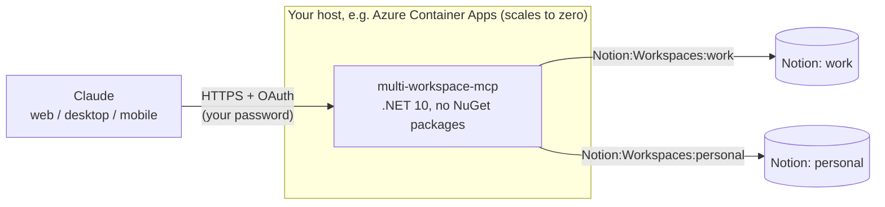

# multi-workspace-mcp

[](https://github.com/guilhermeappel/multi-workspace-mcp/actions/workflows/ci.yml)
[](LICENSE)
[](global.json)

A remote [MCP](https://modelcontextprotocol.io) server that puts **several Notion workspaces behind a single
Claude connector**, for example "work" (Notion A) and "personal" (Notion B). It speaks MCP over Streamable HTTP,
protects itself with a built-in single-user OAuth 2.1 login, and runs on Azure Container Apps within the free
grant. It works in Claude on the web, on desktop and on mobile.



Every tool takes a `workspace` argument. Claude picks the workspace from what you ask ("my work tasks…") and
calls `list_workspaces` when it is unsure.

## Contents

- [Why this exists](#why-this-exists)
- [Features](#features)
- [Quick start](#quick-start)
- [Deploying](#deploying)
- [Tools](#tools)
- [Settings](#settings)
- [Security](#security)
- [Troubleshooting](#troubleshooting)
- [Who this is for](#who-this-is-for)
- [Limitations](#limitations)
- [Project layout](#project-layout)
- [Contributing, security and license](#contributing-security-and-license)

## Why this exists

If you keep a work and a personal Notion workspace, you would otherwise switch accounts or add a connector per
workspace. This server holds one integration token per workspace and lets Claude reach all of them through one
connector, choosing the right one from the conversation.

## Features

- **Many workspaces, one connector.** Add as many as you like with `Notion:Workspaces:<name>`.
- **Eight tools** to search, read, query, create and update pages and databases, with page content exchanged as
  Markdown. See [Tools](#tools).
- **Built-in OAuth 2.1 for one user:** authorization code with PKCE S256, dynamic client registration and a
  password page, with a login throttle.
- **Stateless.** Client IDs, codes and tokens are HMAC-signed documents, so there is no database and the
  container can scale to zero without dropping Claude's connection.
- **Careful writes.** A write is never repeated after a server error or a network failure, and a partial
  multi-request write tells you what already exists.
- **No NuGet packages in the server.** Only the ASP.NET Core shared framework; the MCP protocol is hand-written.
- **Validated settings.** A configuration mistake stops the app with one clear line per problem.
- **Cheap to run.** About 0.25 vCPU and 0.5 GiB, zero to one replica. Scale to zero fits the Azure free grant;
  keeping one replica warm avoids slow first calls (see [Cold start and cost](docs/deployment.md#cold-start-and-cost)).

## Quick start

You need the [.NET 10 SDK](https://dotnet.microsoft.com/download) and a Notion integration token for each
workspace.

### 1. Create a Notion integration

Repeat for **each** workspace:

1. Go to <https://www.notion.so/profile/integrations>, click **New integration**, pick the workspace and the
   **Internal** type.
2. Under **Capabilities**, check *Read content*, *Update content* and *Insert content*
   (only *Read content* for a read-only workspace).
3. Copy the **Internal Integration Secret** (`ntn_…`).
4. **Share pages with the integration.** It only sees what was shared with it: use the integration's **Access**
   tab, or `•••` → **Connections** on a page.

### 2. Configure and run

The server reads its secrets from `dotnet user-secrets` in development, so they stay out of the repository.

```bash
cd src/NotionMultiMcp

dotnet user-secrets set Notion:Workspaces:work "ntn_..."
dotnet user-secrets set Notion:Workspaces:personal "ntn_..."
dotnet user-secrets set Server:AuthPassword "a-long-random-password-of-16-or-more-characters"
dotnet user-secrets set Server:SigningKey "$(openssl rand -hex 32)"

dotnet run   # listens on http://localhost:8080
```

On Windows PowerShell, generate the key with:

```powershell
$key = New-Object byte[] 32; [Security.Cryptography.RandomNumberGenerator]::Create().GetBytes($key)
dotnet user-secrets set Server:SigningKey (($key | ForEach-Object { $_.ToString("x2") }) -join "")
```

User-secrets are only read in Development, which is what `dotnet run` uses. Add `--urls http://localhost:18080`
if port 8080 is busy.

### 3. Try it

**Without OAuth** (testing only; `Server:AuthDisabled` works only in Development):

```bash
Server__AuthDisabled=true dotnet run
```

On PowerShell, set the variable first:

```powershell
$env:Server__AuthDisabled = "true"
dotnet run
```

```bash
curl -s http://localhost:8080/mcp \
  -H 'Content-Type: application/json' \
  -d '{"jsonrpc":"2.0","id":1,"method":"tools/call","params":{"name":"list_workspaces","arguments":{}}}'
```

The response lists each workspace with the real Notion workspace name behind it.

**With the full OAuth flow** (recommended before deploying). Run without `Server:AuthDisabled` and connect
Claude Code:

```bash
claude mcp add --transport http notion-multi http://localhost:8080/mcp
claude    # inside it, run /mcp → notion-multi → Authenticate
```

The browser opens the "Connect to Notion" page. Type the password and you are done: it is the same flow
claude.ai uses. You can also use the MCP Inspector (`npx @modelcontextprotocol/inspector`, *Streamable HTTP*,
URL `http://localhost:8080/mcp`).

### Run with Docker

```bash
docker build -t multi-workspace-mcp .
docker run --rm -p 8080:8080 \
  -e Notion__Workspaces__work="ntn_..." \
  -e Server__AuthPassword="a-long-random-password-of-16-or-more-characters" \
  -e Server__SigningKey="$(openssl rand -hex 32)" \
  multi-workspace-mcp
```

Environment variables put on a command line can end up in your shell history. Prefer `--env-file` with a
file kept outside the repository.

### Tests

```bash
dotnet test NotionMultiMcp.slnx
```

The tests need no Notion account and no network: the app runs in memory against a fake Notion API.

## Deploying

The [deployment guide](docs/deployment.md) walks through publishing the container image with GitHub Actions,
creating the Container App with `deploy/azure-setup.ps1`, setting a cost alert, adding the connector in Claude
and day-to-day operations (logs, updates, adding a workspace, rotating secrets).

The two commands, once the image exists:

```powershell
az login
./deploy/azure-setup.ps1 -Image ghcr.io/<owner>/multi-workspace-mcp:sha-xxxxxxx
```

The script prints the connector URL (`https://<fqdn>/mcp`) to paste in claude.ai → **Settings** →
**Connectors** → **Add custom connector**. The app must run with a single replica; see
[ADR 0003](docs/adr/0003-single-replica-ephemeral-state.md).

## Tools

| Tool | What it does |
|---|---|
| `list_workspaces` | Lists the configured workspaces and the real Notion workspace behind each one |
| `search` | Searches pages and data sources by title |
| `fetch_page` | Reads title, properties and content (as Markdown, including nested blocks) |
| `fetch_data_source` | Shows a database schema: properties, types and options |
| `query_data_source` | Lists rows of a database, with Notion-style filter and sorts |
| `create_page` | Creates a child page or a database row (content as Markdown) |
| `append_content` | Appends Markdown to the end of a page |
| `update_page` | Changes title and properties, or moves a page to the trash and restores it |

Properties accept simple values such as `{"Status":"Done","Tags":["a","b"],"Due":"2026-10-01"}`. The server
converts them using each column's type. The raw Notion API format is accepted too.

Supported Markdown covers headings, paragraphs, lists (up to 2 nesting levels), to-dos, quotes, code blocks,
tables, dividers and images by URL, plus **bold**, *italic*, `code`, ~~strikethrough~~ and links.

Phrases to try in Claude:

- "list my Notion workspaces"
- "search the work Notion for the onboarding page"
- "create a page 'Trip' in my personal Notion with a packing checklist"

## Settings

Settings follow the usual .NET layering, later sources overriding earlier ones: `appsettings.json` (the
non-secret defaults, committed), `appsettings.<Environment>.json`, user-secrets (Development only),
environment variables, and command-line arguments. Everything is checked at startup and a mistake is
reported as one `Configuration error:` line per problem before the server listens.

In an environment variable, write `:` as `__`: `Server:SigningKey` is `Server__SigningKey` and
`Notion:Workspaces:work` is `Notion__Workspaces__work`. A list takes one indexed variable per item
(`Server__ExtraAllowedOrigins__0`). Workspace names are lowercased and `_` becomes `-`, so
`Notion__Workspaces__my_client` is the workspace `my-client`.

| Key | Required | Description |
|---|---|---|
| `Notion:Workspaces:<name>` | yes (at least 1) | Integration token (a secret); `<name>` becomes the workspace name |
| `Server:AuthPassword` | yes (unless `Server:AuthDisabled`) | Secret. Password asked on the authorization page (at least 16 characters, make it long and random) |
| `Server:SigningKey` | yes (unless `Server:AuthDisabled`) | Secret. 32+ random bytes as hex or base64 (for example `openssl rand -hex 32`; a phrase is rejected); signs the tokens |
| `Server:PublicBaseUrl` | in production | `https://<fqdn>` without a trailing slash; defaults to `http://localhost:8080` |
| `Server:TokenGeneration` | no | Positive whole number (default 1); increment it to revoke every issued access and refresh token. An invalid value stops the startup |
| `Server:ExtraRedirectUris` | no | List of extra OAuth callbacks |
| `Server:ExtraAllowedOrigins` | no | List of extra browser origins allowed to call `/mcp` (for example the MCP Inspector's) |
| `Server:AuthDisabled` | no | `true` turns authentication off, **Development only** |
| `Server:AccessTokenLifetime` | no | Default `01:00:00` (1 hour) |
| `Server:RefreshTokenLifetime` | no | Default `90.00:00:00`; slides forward each time the token is used |
| `Server:AuthorizationCodeLifetime` | no | Default `00:05:00` |
| `Server:MaxSessionLifetime` | no | Default `180.00:00:00`; a login can be refreshed for at most this long |

## Security

- **Built-in OAuth 2.1 for a single user.** Claude registers itself (DCR) and uses PKCE S256.
  On authorization you type `Server:AuthPassword`. Each client address gets 10 password attempts per
  15 minutes, and the server 60 overall.
- **Stateless.** Client IDs, codes and tokens are JSON signed with HMAC-SHA256 using `Server:SigningKey`.
  The access token lasts 1 hour and the refresh token 90 days, sliding, within a session that ends 180 days
  after the login. To sign everybody out, increment `Server:TokenGeneration`. Changing `Server:SigningKey`
  invalidates everything, including client registrations.
- **Origin validation.** `/mcp` refuses a request whose `Origin` header is not Claude, this server, a loopback
  address or listed in `Server:ExtraAllowedOrigins` (DNS rebinding defence). Clients that are not browsers send
  no `Origin` and are not affected.
- **Small request bodies.** The OAuth endpoints accept at most 16 KiB and `/mcp` at most 2 MiB.
- **Failures are logged.** Wrong passwords, lockouts and rejected `/mcp` requests show up as warnings in the
  logs (never with the password or a token).
- **Accepted callbacks:** only `claude.ai`/`claude.com` and loopback addresses such as `http://localhost` or
  `http://127.0.0.1` (Claude Code and the Inspector).
- **Notion tokens never leave the server** and never appear in logs.
- **Notion limits access too:** an integration only sees the pages shared with it, and a read-only
  integration cannot write anything.

To report a vulnerability, follow [SECURITY.md](SECURITY.md), which also has the threat model and what to do
when a secret leaks.

## Troubleshooting

| Symptom | Likely cause |
|---|---|
| "Couldn't reach the MCP server" when connecting | `Server:PublicBaseUrl` differs from the real host, or the URL pasted in Claude lacks `/mcp` |
| "Invalid client_id" on the password page | `Server:SigningKey` changed. Remove the connector in Claude and add it again |
| `object_not_found` | The page was not shared with that workspace's integration, or the id belongs to another workspace |
| `restricted_resource` | The integration does not have the write capability ticked |
| 403 from `/mcp` in a browser tool (for example the MCP Inspector) | The page's origin is not allowed. Add it to `Server:ExtraAllowedOrigins` |
| "Couldn't connect" or a slow first call after the server sat idle | Cold start after scaling to zero. It can take 20 seconds or more, which may be longer than the connector waits. Connect again once it is up, or keep one replica running: [Cold start and cost](docs/deployment.md#cold-start-and-cost) |
| Container does not start | Check the logs (`az containerapp logs show`). Usually a required variable is missing, and the error message says which |

## Who this is for

This is a **personal, single-user** server: you run your own copy with your own password and your own Notion
tokens, and you do not share its URL. There is no shared or hosted instance.

Give each Notion integration the smallest capabilities it needs and share only the pages you want Claude to
reach. A page Claude reads can contain text that tries to steer it (prompt injection), so prefer read-only
integrations for workspaces that do not need writes. More in [SECURITY.md](SECURITY.md).

## Limitations

No file uploads, no comments, and no editing of specific blocks (content is only appended to the end). The Markdown
in one call is limited to 100,000 characters; send longer content in several `append_content` calls.
Tables with more than 100 rows and lists with more than 100 sub-items inside a single block exceed the
Notion API limit. Uses Notion API version `2026-03-11`.

## Project layout

```
src/NotionMultiMcp/          server (ASP.NET Core, no NuGet packages)
tests/NotionMultiMcp.Tests/  xUnit tests
deploy/azure-setup.ps1       Azure infrastructure setup (run once)
docs/deployment.md           deployment and operations guide
docs/architecture.md         diagrams: components, OAuth flow, request pipeline, deployment
docs/adr/                    architecture decision records
.github/workflows/ci.yml     style check, build, tests and image on GHCR
.github/workflows/release.yml  versioned image and GitHub release on a vX.Y.Z tag
docs/development.md          architecture, project rules and code standards
CHANGELOG.md, ROADMAP.md     what changed and where the project may go
```

## Contributing, security and license

- [CONTRIBUTING.md](CONTRIBUTING.md) explains the workflow and the project rules (`dotnet build`,
  `dotnet test` and `dotnet format` are all that CI runs).
- [SECURITY.md](SECURITY.md) explains how to report a vulnerability privately.
- [SUPPORT.md](SUPPORT.md) says where to ask for help, [CHANGELOG.md](CHANGELOG.md) lists the changes and
  [ROADMAP.md](ROADMAP.md) lists ideas that are open for discussion.
- Design decisions are recorded in [docs/adr](docs/adr/README.md).
- [CODE_OF_CONDUCT.md](CODE_OF_CONDUCT.md) sets the expectations for the community.
- Released under the [MIT license](LICENSE).
