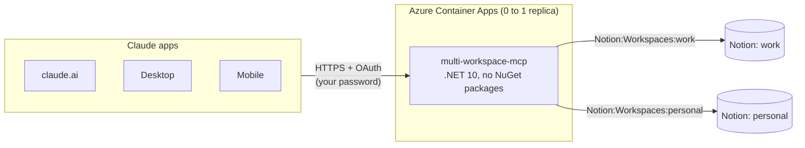
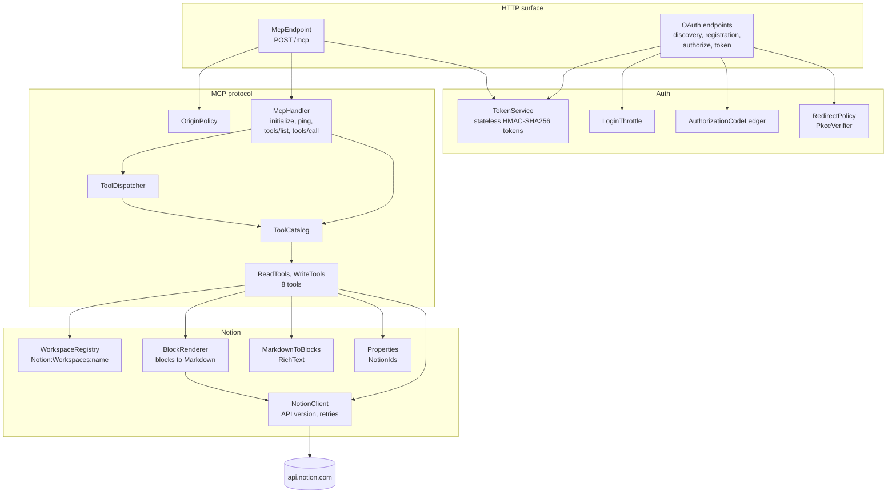
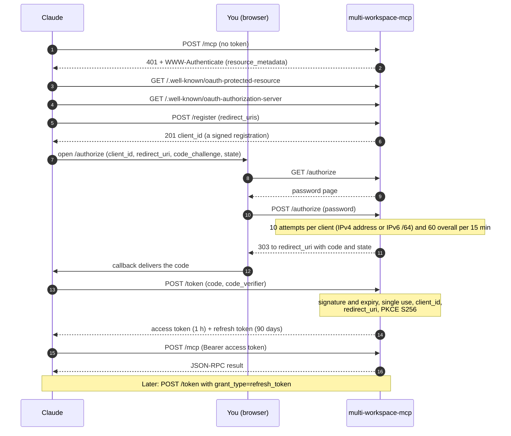
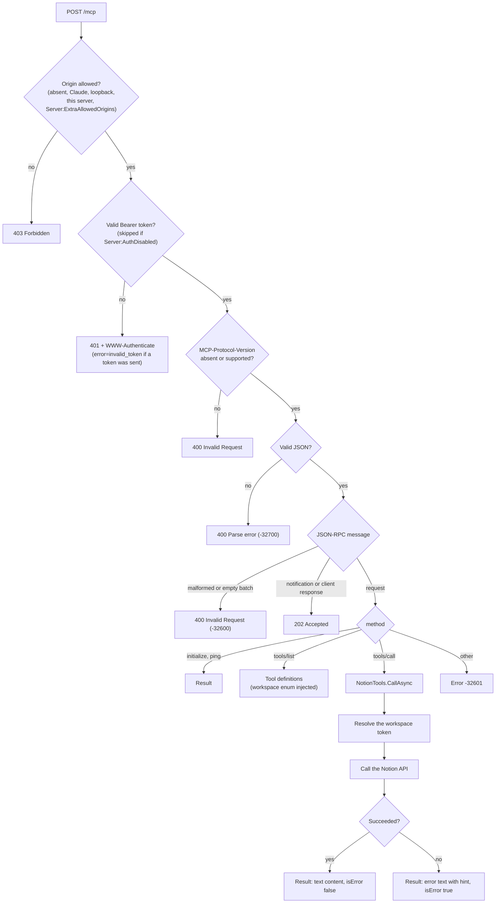
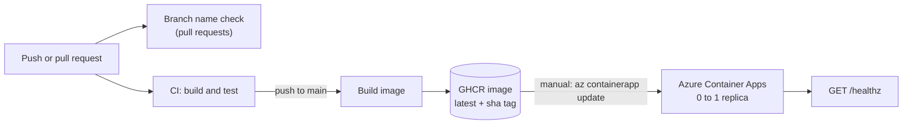

# Architecture

Diagrams are written in [Mermaid](https://mermaid.js.org/), which GitHub renders natively.
Keep this file in sync when the OAuth flow, the token format or the `/mcp` pipeline changes.

## System context



The server is a remote MCP server using the Streamable HTTP transport in stateless mode: every `POST /mcp`
carries one JSON-RPC message (or a batch) and gets the answer as `application/json`. There is no SSE stream
and no session, which is what allows the container to scale to zero.

## Components



`Program.cs` only composes: each area registers itself (`AddOAuthServer`, `AddMcpServer`, `AddNotionClient`) and maps
its own endpoints. The two auth helpers that hold state (`LoginThrottle` and
`AuthorizationCodeLedger`) are in memory and per process, which is why the app runs with a single replica.

## OAuth flow

The server is also a minimal OAuth 2.1 authorization server for one user. Claude discovers it from the
`401` response, registers itself dynamically (RFC 7591) and runs an authorization code flow with PKCE (S256).



The `resource` parameter of `/authorize` (RFC 8707) must name this server: its MCP URL or its base URL, with
or without a trailing slash. Anything else is answered with `invalid_target`.

The login throttle counts an attempt before the password is checked and refunds it when the password is right;
the client address is read from `X-Forwarded-For`, which the Container Apps ingress sets ([ADR 0003](adr/0003-single-replica-ephemeral-state.md)).
The authorization page answers a wrong password with 403 and the redirect after a correct one with 303 See Other
(the browser must follow it with a GET). Registration is limited to 10 redirect URIs and a 200-character client
name.

Accepted redirect URIs are `https://claude.ai/api/mcp/auth_callback`, `https://claude.com/api/mcp/auth_callback`,
any `http://localhost:<port>` callback (Claude Code, MCP Inspector) and anything listed in
`Server:ExtraRedirectUris`. For loopback callbacks the port is ignored when matching (RFC 8252).

## Stateless tokens

Nothing about clients, codes or sessions is stored. Each artifact is a signed JSON document:

```
base64url(json) "." base64url(HMAC-SHA256(Server:SigningKey, purpose + "|" + base64url(json)))
```

The purpose is part of the signed data, so a token issued for one purpose is rejected for any other.

| Purpose | Carries | Lifetime |
|---|---|---|
| `client` | redirect URIs, client name, issue time | until `Server:SigningKey` changes |
| `code` | client hash, redirect URI, PKCE challenge, expiry, nonce | 5 minutes, single use |
| `access` | expiry, generation | 1 hour |
| `refresh` | client hash, expiry, generation, nonce, session start | 90 days, sliding, capped at 180 days after the login |

Revocation: incrementing `Server:TokenGeneration` invalidates every access and refresh token. Changing
`Server:SigningKey` invalidates everything, including client registrations (Claude then needs the connector to be
removed and added again). Single use of authorization codes is enforced by an in-memory ledger, the only
server-side state besides the login throttle.

## Request pipeline: POST /mcp



The order matters. The Origin check comes first, so a request from a browser page cannot even learn whether a
token is valid (the transport specification asks servers to validate `Origin` against DNS rebinding). Clients
that are not browsers send no `Origin` and pass. A message must be JSON-RPC 2.0: a request needs a string or
numeric `id`, and a malformed message or an empty batch is answered with `-32600` and HTTP 400. Inside a batch,
a malformed item gets its own error entry.

Tool failures (`ToolException`, `NotionApiException`) are returned as results with `isError: true`, not as
JSON-RPC errors, so the model can read the message and recover. A JSON array is processed as a batch.

## Notion API calls and failures

`NotionClient` separates reads from writes because Notion can apply a write and still answer with a server
error or time out, and repeating it would duplicate content:

| Call | Rate limit (429) | Server error (5xx), network failure |
|---|---|---|
| `GetAsync`, `PostReadOnlyAsync` (search, query) | retried, honouring `Retry-After` (capped at 10 s) | retried, up to 3 attempts |
| `PostAsync`, `PatchAsync` (create, update, append) | retried (nothing was applied) | **not** retried; reported with a hint that the write may have been applied |

Content longer than 100 blocks is sent in batches (the page is created with the first 100, the rest is appended).
If a later batch fails, `create_page` and `append_content` do not return a plain error: they say that the page
exists (with its id and url), how many blocks landed, and not to repeat the call, so the model neither creates the
page twice nor appends the same blocks again.

Timeouts and unreachable hosts become tool errors (`timeout`, `unreachable`) instead of generic failures.

## Reading a page

Property types the server does not know how to read are shown as `[unsupported property type: <type>]` rather than
being left out, the same way unsupported block types leave a marker.

`fetch_page` renders a page as Markdown. `BlockRenderer` lists the children of a block with pagination
(100 per request), recurses into nested blocks up to a depth of 4, flattens columns and synced blocks,
renders tables from their rows, and stops after a budget of 1,500 blocks (the output says when it was
truncated).

## Build and deployment



Deployment is a manual step on purpose: CI publishes the image, and you decide when to roll it out.
The infrastructure is created once with `deploy/azure-setup.ps1`.
